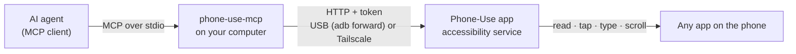

<div align="center">


# Phone-Use

**Let an AI agent use an Android phone.** Read the screen, tap, type, scroll, open apps and take screenshots, from any MCP client or a terminal.

[](https://github.com/luckeyfaraday/phone-use/actions/workflows/ci.yml)
[](https://github.com/luckeyfaraday/phone-use/releases)
[](LICENSE)


</div>

Phone-Use pairs a small Android app with an MCP server and CLI that run on your computer. The agent sees the phone as a numbered list of on-screen elements and can act on them. It works with Claude Code, Codex, Claude Desktop, Cursor and any other client that supports MCP over stdio. You don't need root, a cloud account, or Node.js on the phone.

## How it works



Android's accessibility service supplies the visible elements and performs the gestures. Screenshots are optional and go through Android's screen-sharing consent prompt. A **Stop** pill stays on screen while an agent is reading or acting, so the person holding the phone is always in control.

## Features

- **Works with any app.** Numbered elements with role, text, view ID, position and what you can do with them. Screenshots cover images, maps, games and canvas apps.
- **11 MCP tools**, plus the same actions from the terminal.
- **Consent stays on the phone.** You enable accessibility and approve screen sharing yourself; setup never grants either on your behalf.
- **Stop at any time.** Stop blocks every read and action. Only the phone can resume.
- **USB first, Tailscale optional.** Pair over USB, then unplug and keep going over your tailnet.
- **Small.** A ~40 KB APK built with the bare Android SDK, and a Node.js CLI with no npm dependencies.

## Requirements

- An Android phone running **Android 7.0** or newer, with USB debugging enabled
- **Node.js 18** or newer
- [Android platform-tools](https://developer.android.com/tools/releases/platform-tools) (`adb`) on your `PATH`
- A USB data cable for the first pairing

## Quick start

Install the CLI from the GitHub release. The package includes the APK.

```sh
npm install -g https://github.com/luckeyfaraday/phone-use/releases/download/v0.1.0/phone-use-mcp-0.1.0.tgz
phone-use-mcp setup
```

1. On the phone, enable **Developer options** and **USB debugging**. Connect the cable and approve Android's USB debugging prompt.
2. Run `phone-use-mcp setup`. It installs Phone-Use and opens it on the phone.
3. Tap **Enable accessibility**, choose **Phone-Use**, and turn it on in Android's settings.
4. *Optional, for screenshots:* return to Phone-Use, tap **Allow screenshots**, and approve Android's screen-sharing prompt.

Setup waits for the service to connect, then saves the token and device in `~/.config/phone-use/config.json`. The token is never printed.

Several phones connected? Pick one with `--serial DEVICE_ID` (see `adb devices`). Use `--port 7444` if the computer's default port is taken, `--apk /path/to/phone-use.apk` to install another build, or `--timeout 300` for more time.

## Connect your agent

**Claude Code**

```sh
claude mcp add phone-use -- phone-use-mcp mcp
```

**Codex**

```sh
codex mcp add phone-use -- phone-use-mcp mcp
```

**Claude Desktop, Cursor and other clients:** run `phone-use-mcp config` to print a configuration with absolute paths, then add it to your client's MCP settings:

```json
{
  "mcpServers": {
    "phone-use": {
      "command": "phone-use-mcp",
      "args": ["mcp"]
    }
  }
}
```

Restart or reconnect your agent's tools, then try:

> Use phone_screen to see my phone, then open Settings and tell me the Android version.

The server negotiates MCP protocol revisions 2024-11-05 through 2025-11-25. Tool calls run in order. Use one controlling agent per phone: element numbers refer to the latest screen read, including the screens that actions return.

## Tools

| Tool | What it does |
| --- | --- |
| `phone_screen` | Foreground app and a numbered list of visible elements |
| `phone_screenshot` | JPEG of the screen, optionally scaled |
| `phone_tap` | Tap an element number or an `x, y` point |
| `phone_long_press` | Long-press an element or a point |
| `phone_type` | Set the text of the focused field or a given element, optionally appending |
| `phone_scroll` | Scroll up, down, left or right, optionally inside a specific list |
| `phone_swipe` | Swipe between two points over a set duration |
| `phone_key` | Back, Home, Recents, notifications or quick settings |
| `phone_open_app` | Open an installed app by name or package |
| `phone_list_apps` | List launchable apps, optionally filtered |
| `phone_status` | Reachability, pause state, screenshot readiness, Android version and model |

Actions return the screen as it looks afterwards, so the agent rarely needs a separate read.

## Use from the terminal

```sh
phone-use-mcp doctor                  # check adb, the saved configuration and the phone
phone-use-mcp status
phone-use-mcp screen
phone-use-mcp apps
phone-use-mcp open Settings
phone-use-mcp tap 4                   # element number from the latest screen
phone-use-mcp tap 360 800             # or a point in screen pixels
phone-use-mcp type 'Hello 👋' --id 7
phone-use-mcp scroll down
phone-use-mcp key back
phone-use-mcp screenshot ./screen.jpg
phone-use-mcp pause
```

`screenshot FILE` writes a JPEG to the path you give it and refuses to overwrite an existing file. Run `phone-use-mcp --help` for every command.

## Stop and resume

Tap **Stop** on the on-screen pill or in the Phone-Use app, or run `phone-use-mcp pause`. While paused, screen reads, app lists, screenshots and actions all return an error; status stays available. Pausing survives app restarts and ends the screen-sharing session.

Resume from the phone, using the pill or the app. There is deliberately no remote resume. Allow screenshots again after resuming if you want them. To revoke access entirely, turn Phone-Use off in Android's accessibility settings.

## Wi-Fi and Tailscale

Finish USB setup first so the computer has the phone's token. Then turn on **Wi-Fi / Tailscale access** in the app, or do it over USB:

```sh
phone-use-mcp network on
phone-use-mcp connect http://YOUR_PHONE_TAILSCALE_IP:7333
phone-use-mcp doctor
```

`connect` tests the address before saving it. You can now unplug the cable. Both devices must be on the same tailnet; install and configure Tailscale separately. To go back, run `phone-use-mcp network off` over USB or tap **Use USB only** in the app, then rerun setup.

Environment overrides: `PHONE_USE_URL`, `PHONE_USE_TOKEN`, `ANDROID_SERIAL`, `PHONE_USE_DEVICE_PORT` (default 7333) and `PHONE_USE_CONFIG_DIR`. A network-only client needs the URL and token, but not `adb`.

## Security and privacy

- **USB mode** listens only on the phone's loopback address, reached through `adb forward`.
- **Network mode** listens on every interface and requires the same random token on every request. The phone's HTTP server has no TLS, so use Tailscale or another encrypted tunnel and **never expose port 7333 to the internet**.
- The token is readable only through Android's ADB shell (or root), so pairing requires a phone that already trusts your computer for debugging.
- Screenshots are produced on request and returned in memory. Nothing is saved on the phone. Your agent may keep images in its own conversation history.
- Mutating actions are never retried automatically: after a timeout, read the screen before trying again.

To report a vulnerability, see [SECURITY.md](SECURITY.md).

## Troubleshooting

- **Unauthorized device:** unlock the phone and accept its USB debugging prompt, then rerun `adb devices`.
- **Accessibility is unavailable:** some Android versions restrict accessibility for sideloaded apps. Check the app's info screen for restricted settings, then return to accessibility settings.
- **Phone not answering:** run `phone-use-mcp doctor`. Check the cable or network, the selected device and the accessibility setting. Android may turn accessibility off after a force-stop. Rerun setup after reinstalling the app, because the token changes.
- **Screenshots need approval:** open Phone-Use and allow screen sharing. Android may end the session when the phone locks, the app stops or you stop sharing. Protected content can appear blank.
- **An action timed out:** read the screen before retrying. The action may have happened even if its response was lost.
- **Codex rejects the tools:** with `approval_policy = "never"`, Codex declines MCP tool calls unless the server allows them. Add `default_tools_approval_mode = "approve"` under `[mcp_servers.phone-use]` in `~/.codex/config.toml`. That lets Codex act on the phone without asking each time.
- **Wrong signature on update:** install builds signed with the same key, or uninstall Phone-Use first. Uninstalling resets the pairing token and permissions.

## Build from source

Prerequisites: JDK 11+, an Android SDK platform and build-tools, `zip`, and Node.js 18+. The app uses the bare SDK tools: no Gradle and no third-party runtime dependencies.

```sh
git clone https://github.com/luckeyfaraday/phone-use.git
cd phone-use
./android/build.sh       # builds android/build/phone-use.apk
./android/test.sh        # HTTP parser tests
cd mcp
npm test
npm pack                 # bundles the fresh APK, README and license
npm install -g ./phone-use-mcp-0.1.0.tgz
```

`ANDROID_HOME` or `ANDROID_SDK_ROOT` selects the SDK (default `~/Android/Sdk`); `ANDROID_PLATFORM` and `BUILD_TOOLS_VERSION` pin versions. Local builds create `android/debug.keystore`, which Git ignores. Keep it to install later builds over the existing app. CI builds use throwaway keys and are for testing only.

## Documentation

- [HTTP API](docs/API.md): the phone-side endpoints, for clients that don't use MCP
- [Testing and compatibility](docs/TESTING.md)
- [Releasing](docs/RELEASING.md)
- [Changelog](CHANGELOG.md)

## Contributing

Bug reports, device compatibility notes and pull requests are welcome. See [CONTRIBUTING.md](CONTRIBUTING.md) to get started, and please follow the [code of conduct](CODE_OF_CONDUCT.md).

## License

[MIT](LICENSE)
