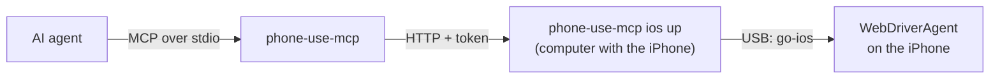

# iPhone

iOS doesn't let an app on the iPhone read or operate other apps, so on an iPhone Phone-Use runs from a computer. [WebDriverAgent](https://github.com/appium/WebDriverAgent), the open-source UI test runner behind Appium, runs on the iPhone. [go-ios](https://github.com/danielpaulus/go-ios) starts it over USB. `phone-use-mcp ios up` keeps both running and serves the same API as the Android app, so agents use the same `phone_*` tools on either phone.



The iPhone stays connected to that computer by USB. Agents on the same computer, or anywhere on your tailnet, reach it through `ios up`.

## Requirements

- An iPhone with Developer Mode enabled. Tested on iOS 26 (iPhone 13 Pro).
- A computer running Linux, macOS or Windows with Node.js 18 or newer. Linux is tested; go-ios also supports macOS and Windows. On Linux, install `usbmuxd` (for example `sudo apt install usbmuxd`).
- [go-ios](https://github.com/danielpaulus/go-ios/releases) 1.3 or newer. Put its `ios` binary on your `PATH`, or pass `--go-ios /path/to/ios`. The `go-ios` npm package is out of date: use the GitHub release.
- WebDriverAgent signed with your Apple ID and installed on the iPhone (next section).

## 1. Prepare the iPhone

1. Connect the iPhone by USB, unlock it, and tap **Trust** when it asks about this computer.
2. Turn on **Settings → Privacy & Security → Developer Mode**, then restart when asked. If the setting is missing, run `ios devmode reveal` with the iPhone connected.

## 2. Install WebDriverAgent

1. Download `WebDriverAgentRunner-Runner.zip` from [WebDriverAgent's releases](https://github.com/appium/WebDriverAgent/releases) and unzip it. It's built for real devices, but unsigned.
2. Sign `WebDriverAgentRunner-Runner.app` with your Apple ID and install it on the iPhone. iOS only runs apps signed for your device:
   - **macOS:** follow Appium's [real device setup](https://appium.github.io/appium-xcuitest-driver/latest/preparation/real-device-config/) to sign WebDriverAgent with Xcode.
   - **Linux, Windows or macOS without Xcode:** use a sideloading tool that signs a whole app bundle, **including its `PlugIns/*.xctest` test bundle**. As of October 2026, [Impactor](https://github.com/claration/impactor)'s `plumesign` 2.7.1 can't sign in with some Apple IDs ([#35](https://github.com/claration/impactor/issues/35), [#298](https://github.com/claration/impactor/issues/298)) and leaves `.xctest` bundles unsigned, so iOS refuses to start WebDriverAgent. Check its issues before relying on it.
   - A free Apple ID needs a unique bundle ID for the app (sideloading tools usually set one). `ios setup` finds any installed WebDriverAgent runner, or takes `--bundle-id`.
3. On the iPhone, trust your developer certificate: **Settings → General → VPN & Device Management**, tap your Apple ID, then **Trust**.

Profiles from a **free Apple ID expire after 7 days**. Re-sign and reinstall WebDriverAgent before then, over USB. A paid Apple Developer account signs for a year.

## 3. Set up and run

```sh
phone-use-mcp ios setup
phone-use-mcp ios up
```

`ios setup` checks go-ios, the iPhone, Developer Mode and WebDriverAgent, then saves the configuration and a random token in `~/.config/phone-use/config.json`. Use `--udid` when several iPhones are connected.

`ios up` starts the iOS 17+ tunnel (in userspace, no root), mounts the developer disk image and launches WebDriverAgent. It restarts any piece that stops, and serves the phone-use API at `http://127.0.0.1:7334`. Leave it running. If the iPhone isn't connected yet, it waits for it. Logs are in `~/.config/phone-use/ios/logs/`, and go-ios keeps its pairing keys in `~/.config/phone-use/ios/pairing/`.

In another terminal, try `phone-use-mcp screen`. Then [connect your agent](../README.md#connect-your-agent) exactly as for Android.

To run `ios up` in the background on Linux, use a systemd user service:

```ini
# ~/.config/systemd/user/phone-use-ios.service
[Unit]
Description=Phone-Use iPhone host

[Service]
ExecStart=/usr/bin/env phone-use-mcp ios up
Environment=GO_IOS=/path/to/ios
Restart=always

[Install]
WantedBy=default.target
```

```sh
systemctl --user enable --now phone-use-ios
```

If you start WebDriverAgent yourself (for example from Xcode), run `phone-use-mcp ios up --wda-url http://127.0.0.1:8100` and it only serves the API.

To serve the API on a port other than 7334, run `phone-use-mcp ios setup --port N` again.

## Stop and resume

**Lock the iPhone to stop the agent.** While the iPhone is locked, every read and action fails with a "locked" error; status still works. If you lock it in the middle of an action, the action's reply doesn't include the screen. Phone-Use never unlocks the iPhone, so it resumes only when someone unlocks it with Face ID, Touch ID or the passcode.

`phone-use-mcp pause` locks it from the computer, but WebDriverAgent handles one request at a time, so it can wait for an action already in progress. The side button stops it immediately.

The iPhone also locks itself after its Auto-Lock delay, which pauses the agent the same way. For long tasks, lengthen **Settings → Display & Brightness → Auto-Lock**.

To revoke access entirely, stop `ios up` or delete WebDriverAgent from the iPhone.

## Other computers

`phone-use-mcp ios up --network` listens on every interface, not just this computer. On another computer on your tailnet, use the `token` from this computer's `~/.config/phone-use/config.json`:

```sh
PHONE_USE_TOKEN=THE_TOKEN phone-use-mcp connect http://THIS_COMPUTERS_TAILSCALE_IP:7334
```

`connect` tests the address and saves it with the token. As on Android, the API has no TLS: use Tailscale or another encrypted tunnel, and don't expose the port to the internet.

## Differences from Android

- Coordinates are iOS **points** (for example 390×844), not pixels. `phone_screen` shows the screen size, and screenshots say how to convert image coordinates.
- iOS has no Back key. `back` swipes in from the left edge, so prefer an app's own Back button when one is listed. `recents` opens the app switcher, and `quick_settings` opens Control Center.
- `notifications` isn't available. On iOS, Notification Center is the lock screen's cover sheet, and while it's open the iPhone reports itself as locked, which pauses phone-use. The same applies if you pull it down yourself: the agent waits until you close it.
- Ending typed text with `\n` presses Return.
- Screenshots are PNG. Coordinates are tested in portrait.
- Each action takes about 2–5 seconds, including reading the screen it returns. Complex screens, such as long web pages, take longer.
- `recents` and `quick_settings` are tuned for Face ID iPhones and aren't available on iPhones with a Home button.
- Apps are opened by bundle ID (for example `com.apple.Preferences`). `phone_open_app` also accepts the app's name as the iPhone shows it, in its language: Settings is "Ajustes" on an iPhone set to Spanish. `phone_list_apps` shows both.

## Security

- `ios up` listens only on this computer unless you pass `--network`, and every request needs the token.
- WebDriverAgent has no authentication of its own, so `ios up` never gives it a network port. It starts WebDriverAgent with `USE_IP=127.0.0.1`, so the iPhone doesn't accept connections to it over Wi-Fi, and reaches it over USB through usbmuxd. The only way in is the token-protected `ios up` API.
- If you start WebDriverAgent another way, it listens on the iPhone's Wi-Fi address **without authentication**: anyone on that network can operate the iPhone while it runs. Forwarding its port with `ios forward` also exposes it on every network interface of the computer.
- WebDriverAgent can operate everything on the iPhone while it runs. Delete it from the iPhone when you no longer use Phone-Use.

## Troubleshooting

- **"No iPhone found":** unlock the iPhone and tap Trust. On Linux, check that `usbmuxd` is installed; it starts when an iPhone is plugged in.
- **WebDriverAgent doesn't start:** look at `wda.log` and `wda-device.log` in `~/.config/phone-use/ios/logs/`. Common causes: the iPhone is locked, the developer certificate isn't trusted yet, or the 7-day profile expired (re-sign and reinstall).
- **The developer disk image won't download (Linux):** `ios up` adds Apple's root certificate to go-ios's trust store automatically. If you set `SSL_CERT_FILE` yourself, include [Apple Root CA](https://www.apple.com/appleca/AppleIncRootCertificate.cer) in that file.
- **"The iPhone is locked":** unlock it. If it keeps locking during a task, lengthen Auto-Lock.
- **The tunnel won't start:** another go-ios tunnel may already be running. Stop it, or let `ios up` use it.
